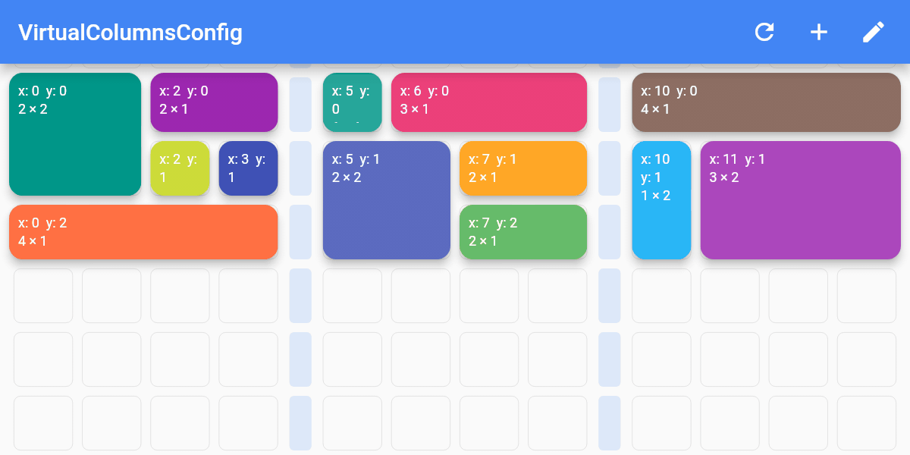
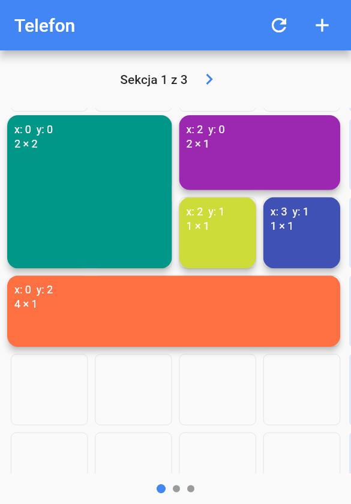
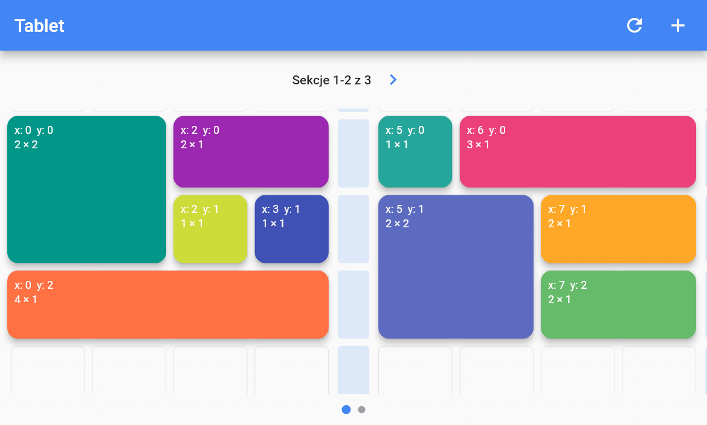
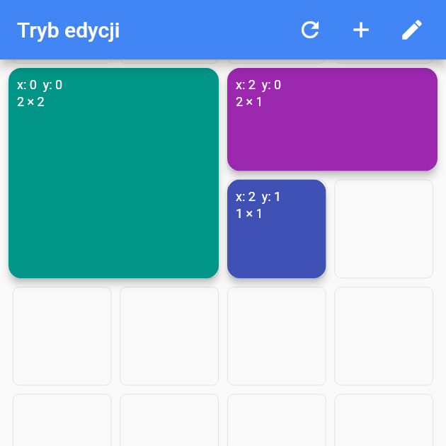
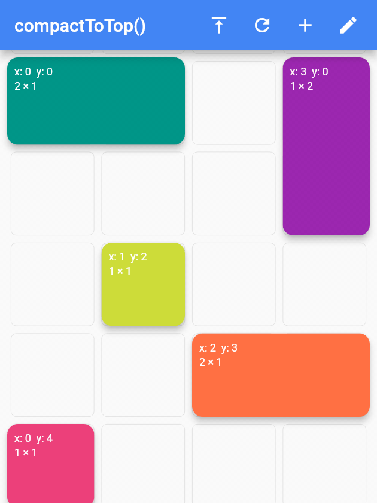

Fork from https://github.com/Mehmetyaz/dashboard

Dynamic dashboard widget that allows your users to create their own layouts. Rezise, move, indirect resize/move, auto  re-layout are supported.

## Features

[Try online demo](https://styledart.dev/#/dashboard)

Dashboard can be thought of as a dynamic grid. Your users can create their own layouts, add new widgets or remove widgets.

Layout divides the screen into horizontal slots according to the entered value. The aspect ratio of the slots also determine their height. Widgets called DashboardItem are placed in these slots. This layout can be changed later.


### Resize


Dashboard Items can be resized both by long pressing on mobile and by holding and moving on desktop/browser.

### Move


Dashboard Item locations can be changed by long pressing on mobile or by holding and pulling on desktop/browser.

### Slots Changes

With dynamic slot count, you can re-layout window size changes.


## Added in this fork

The animations below are recorded from the package itself, with real gestures,
by `tool/doc_screenshots_test.dart`; regenerate them after a visual change with
`flutter test tool/doc_screenshots_test.dart` (needs `ffmpeg`).

### Column sections (virtual columns)

Disabled columns split the grid into sections. Items cannot be placed in or
across them, and they take a fixed share of the grid width (or none at all
with `VirtualColumnsConfig.hidden`).



```dart
Dashboard(
  slotCount: 14,
  virtualColumnsConfig: const VirtualColumnsConfig.visible(
    disabledColumns: [4, 9],   // three sections of four columns
    disabledColumnWidth: 0.04, // 4% of the grid width each
  ),
  ...
)
```

### Sections on phones and tablets

`MobileDashboardWrapper` keeps the desktop layout and shows it section by
section below the breakpoints: one section on a phone, two on a tablet, with a
header, page dots and arrows. Changing pages does not rebuild the grid.

 

```dart
MobileDashboardWrapper(
  dashboardItemController: controller,
  slotCount: 14,
  columnsPerPage: 4,
  virtualColumnsConfig: columns,
  mobileConfig: const MobileCarouselConfig(
    visibleSectionsOnMobile: 1,
    visibleSectionsOnTablet: 2,
  ),
  dashboardBuilder: (controller, slotCount, startColumn, isMobile) =>
      Dashboard(dashboardItemController: controller, slotCount: slotCount, ...),
)
```

### Resize and delete handles

In edit mode every item can carry a resize handle (bottom right) and a delete
button (top right), both built by you.



```dart
EditModeSettings(
  resizeHandleBuilder: (context, item, isEditing) => const Icon(Icons.open_in_full),
  deleteHandleBuilder: (context, item, isEditing, onDelete) =>
      IconButton(icon: const Icon(Icons.delete), onPressed: onDelete),
)
```

### Compact to top

`DashboardItemController.compactToTop()` closes the vertical gaps left after
moving or deleting items, and returns the identifiers it moved.



### Storage Delegate

The layout information of the users can be stored in the database or on the local disk.

Define your storage delegate.

```dart
class MyItemStorage extends DashboardItemStorageDelegate {  

  @override  
  FutureOr<List<DashboardItem>> getAllItems(int slotCount) {  
    // return items from db.
  }  
  
  @override  
  FutureOr<void> onItemsUpdated(  
      List<DashboardItem> items, int slotCount) {
      // save new layouts to db.
  }
  //[...]
}
```

And use it.

```dart
DashboardItemController.withDelegate(
    itemStorageDelegate: MyItemsStorage())
```


## Getting started

### Define Dashboard

```dart
Dashboard(  
  dashboardItemController: itemController,  
  itemBuilder: (item) {
	//return widget
  },  
);
```

### Define Items

Items can come from the database, or can be defined as fixed.

Fixed:
```dart
DashboardItemController(items: [
  DashboardItem(width: 2, height: 3, identifier: "id_1"),  
  DashboardItem(  
      startX: 3, startY: 4, width: 3, height: 1, identifier: "id_2"),  
]);
```

Or with delegate:

```dart
DashboardItemController<ADashboardItemImp>.withDelegate(  
    itemStorageDelegate: MyItemStorage())
```

[See example](https://pub.dev/packages/dashboard/example)


### Define Builder

The Builder is invoked with a DashboardItem and returns a widget.

```dart
Dashboard(  
  dashboardItemController: itemController,  
  itemBuilder: (item) {
	return Text(item.identifier);
  },  
);
```

## Parameters

### Item Style

Each item is wrapped with a Material widget. You can enter the parameters of the Material widget with item style.

All is optional.
```dart
ItemStyle(  
  color: Colors.red,  
  borderRadius: BorderRadius.circular(10),  
  shape: const RoundedRectangleBorder(),  
  shadowColor: Colors.black,  
  animationDuration: const Duration(milliseconds: 200),  
  borderOnForeground: false,  
  clipBehavior: Clip.antiAliasWithSaveLayer,  
  elevation: 10,  
  textStyle: const TextStyle(color: Colors.black),  
  type: MaterialType.card  
);
```

#### Slide

Slide to top items initially. Auto relayout places items to top as possible.

```slideToTop: true```

Before: 


After: 


#### Shrink

Shrink items when re-layout or editing is possible.


### Edit Mode Settings

EditModeSettings contains parameters related to gesture, animations, resizing.

```dart
EditModeSettings(
  resizeCursorSide: 10, // Resize side width
  paintBackgroundLines: true, // Paint background lines
  fillEditingBackground: true, // Fill editing item background
  longPressEnabled: true, // Start resize or move with long press
  panEnabled: true, // Start resize or move with pan
  backgroundStyle: EditModeBackgroundStyle(), // Background style
  curve: Curves.easeOut, // Animation curve
  duration: Duration(milliseconds: 300), // Animation duration
  shrinkOnMove: true, // Shrink items on moving if necessary
  draggableOutside: true, // Items can be dragged outside the viewport
  autoScroll: true, // Viewport will scroll automatically when item is dragged outside
  resizeHandleBuilder: (context, item, isEditing) {
    // Custom resize handle widget displayed in bottom-right corner during edit mode
    return Container(
      width: 20,
      height: 20,
      decoration: BoxDecoration(
        color: Colors.blue,
        shape: BoxShape.circle,
      ),
      child: Icon(Icons.open_in_full, color: Colors.white, size: 12),
    );
  },
)
```

#### Custom Resize Handle

The `resizeHandleBuilder` parameter allows you to display a custom widget in the bottom-right corner of each dashboard item during edit mode. This provides a more visible and user-friendly way to resize items.

**Parameters:**
- `context`: The build context
- `item`: The dashboard item being edited
- `isEditing`: Whether the item is currently in edit mode

**Example:**
```dart
resizeHandleBuilder: (context, item, isEditing) {
  return Container(
    width: 24,
    height: 24,
    decoration: BoxDecoration(
      color: Colors.blue.withOpacity(0.8),
      shape: BoxShape.circle,
      boxShadow: [
        BoxShadow(
          color: Colors.black26,
          blurRadius: 4,
          offset: Offset(2, 2),
        ),
      ],
    ),
    child: Icon(
      Icons.open_in_full,
      color: Colors.white,
      size: 14,
    ),
  );
}
```

If `resizeHandleBuilder` is null, no custom resize handle is displayed, and resizing works through the traditional edge detection method.

### Storage Delegate

[See example](https://pub.dev/packages/dashboard/example)


TODO  
 - [ ] Define and fix animation bugs.
 - [ ] Check performance improvements.
 - [ ] Write tests.
 - [ ] Add more documentation.
 - [ ] Add more example.
 - [ ] Create Youtube video.